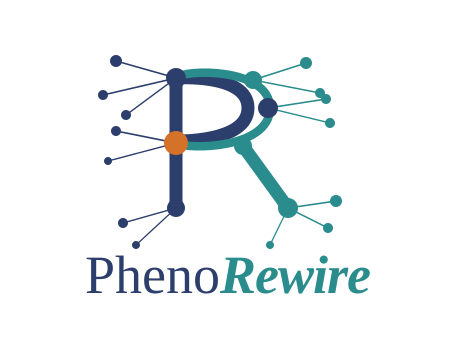

<p align="center">
  
</p>

<p align="center">
  <a href="https://doi.org/10.64898/2026.08.29.748013"></a>
  <a href="CHANGELOG.md"></a>
  <a href="LICENSE"></a>
  <a href="https://www.python.org/downloads/"></a>
  <a href="https://github.com/ldellavedova/PhenoRewire/actions/workflows/tests.yml"></a>
</p>

# PhenoRewire

**PhenoRewire finds the metabolites that change how they relate to one another between two biological states, and tests whether that change is real.**

Metabolites do not vary on their own. They rise and fall together, in patterns that follow the pathways producing and consuming them. When a system is perturbed, those patterns can be rearranged even where the concentrations themselves barely move. PhenoRewire measures that rearrangement and tests it against chance.

It works with any organism, any sample type and any mass spectrometry platform. All it needs is a table of metabolite intensities and two groups to compare. The method is described and applied in [Della Vedova *et al.*, bioRxiv 2026](https://doi.org/10.64898/2026.08.29.748013).

> **Intended for research use.** PhenoRewire proposes hypotheses about how metabolites relate to one another. It does not establish mechanism or causation, and it is not a diagnostic device.
>
> Feedback is welcome. Bug reports, questions and suggestions belong in the [issue tracker](https://github.com/ldellavedova/PhenoRewire/issues); contributions are described in [CONTRIBUTING.md](CONTRIBUTING.md).

---

## What is PhenoRewire?

Most metabolomics studies ask which metabolites go up or down between groups. PhenoRewire asks a different question: *did the way metabolites co-vary with one another change?*

Given a feature table, sample metadata and a configuration file, PhenoRewire:

1. **selects** the metabolites that enter the analysis, either because their concentration differs between the states or because their correlation partners do
2. **builds** one Spearman correlation network per state
3. **compares** the two networks edge by edge, labelling every pair of metabolites as kept, gained, lost or reversed
4. **tests** the comparison against chance, by shuffling the state labels and rebuilding both networks many times over
5. **exports** GraphML networks for Cytoscape, CSV tables for spreadsheet review, and a written report

PhenoRewire is for hypothesis generation. It finds correlational reorganisation, not causal mechanisms.

---

## Why use it?

A metabolite can rewire substantially with no change in mean concentration, and the other way round. The two signals are complementary. Rewiring analysis is useful when:

- differential abundance returns long lists with no clear priorities
- you expect coordinated shifts that no single feature shows on its own
- you want the hub metabolites whose correlation context changes between groups or timepoints
- a treatment, a genotype or the passage of time reorganised the system without moving many concentrations

What it adds, concretely:

- **metabolites that change partners but not concentration.** On simulated data containing such metabolites, a differential abundance test recovers none of them at any sample size. PhenoRewire recovers two thirds with 14 samples per state, and all of them with 25
- **the relationships themselves**, every pair labelled, so a change in concentration can be read together with whatever it changed alongside
- **one p-value for the comparison as a whole**, with differences in concentration taken out of the comparison first

And what it does not do:

- it does not infer mechanism or direction: a correlation between two metabolites is not evidence that one produces the other
- it does not make a small experiment larger; below its working range it says so, and usually finds nothing
- it does not separate conditions that were pooled into one state, which have to be compared separately

PhenoRewire does not replace differential abundance. It answers the question differential abundance cannot pose.

---

## What do you get?

```text
results/phenotype_example/
├── REPORT.md                        ← start here: the result in words, warnings, what to open
├── Reference_vs_Case/               one folder per comparison
│   ├── rewiring_vs_chance.csv       1. do the two networks differ more than chance?
│   ├── rewired_metabolites.csv      2. one row per metabolite, strongest evidence first
│   ├── selected_metabolites.csv     3. which metabolites entered the networks, and why
│   ├── rewiring_network.graphml     4. both networks in one file, for Cytoscape
│   └── details/                     every feature's statistics, each network, every edge
└── run_info/                        run log, input check, configuration used, preprocessed data
```

The four files to read, in order:

| Output | Description |
|---|---|
| `REPORT.md` | The run in plain sentences: what was found, any warnings, and which file to open first |
| `rewiring_vs_chance.csv` | Whether the two networks differ more than an arbitrary split of the same samples would. Read it before anything else |
| `rewired_metabolites.csv` | One row per metabolite: how many of its correlations changed, whether that is more than chance, how it was selected, and which way its concentration moved |
| `rewiring_network.graphml` | Both networks in one file for Cytoscape, with the rewiring score on each node |

Column definitions and how to read them: [`docs/reading_the_results.md`](docs/reading_the_results.md).

### Molecular network annotation (optional)

PhenoRewire selects features by how they behave, not by what they are, so some of the most rewired features will have no confident annotation. With `--run-2dnetwork` it projects them onto a molecular network supplied as GraphML, such as one exported from GNPS, and propagates annotation from their spectral neighbours:

| Output | Description |
|---|---|
| `annotation_summary.csv` | One row per prioritised feature, with neighbour counts and annotation confidence |
| `annotation_expansion.csv` | One row per feature-neighbour pair across the molecular network |
| `annotation_first_neighbours.csv` | First-hop neighbours only |
| `subnetworks/` | One GraphML per prioritised feature, for inspection in Cytoscape |

A demo molecular network is bundled, so the command runs on the example data as it stands. How to read the result: [`docs/interpret_2d_network.md`](docs/interpret_2d_network.md).

---

## Installation

```bash
git clone https://github.com/ldellavedova/PhenoRewire
cd PhenoRewire
pip install -e .
```

Python 3.9 or later. To use conda instead: `conda env create -f environment.yml && conda activate phenorewire`. Two optional extras are available: `pip install -e ".[viz]"` adds the network figures, `".[dev]"` adds the test suite.

## Quick start

```bash
phenorewire --config config_phenotype.yaml --check   # 1. inspect the data, run nothing
phenorewire --config config_phenotype.yaml           # 2. run (about 10 s)
phenorewire --config config_temporal.yaml            # two timepoints within one group
phenorewire --config config_phenotype.yaml --run-2dnetwork   # annotate via a molecular network
```

Then open `results/phenotype_example/REPORT.md`. Both example datasets are simulated, so the right answer is known beforehand; [`data/README.md`](data/README.md) gives it alongside what the run actually returns.

The run reports each stage as it finishes:

```text
[3/6] Selecting metabolites: Reference vs Case
      32 metabolites selected: 11 by abundance only, 11 by change in co-variation partners
      only, 10 by both

[5/6] Comparing the networks: Reference vs Case
      26 correlations shared, 55 only in Reference, 31 only in Case
      testing against chance (200 permutations of the state labels) ...
      the networks differ more than chance (86 state-specific correlations vs 35.7 expected,
      p = 0.005); 18 metabolite(s) rewire more than chance (q <= 0.05).
```

## Input files

PhenoRewire reads two comma-separated tables.

The **feature table** has one row per metabolite feature: the identifier columns first, then one intensity column per sample. Intensities must be positive and unscaled, because PhenoRewire normalises and log-transforms them itself.

| feature_id | mz | rt | name | Sample_01 | Sample_02 | … |
|---|---|---|---|---|---|---|
| F001 | 133.014 | 0.98 | lactate | 15230.4 | 18820.1 | … |

The **metadata table** has one row per sample, with whichever columns define the groups and the timepoints.

| sample_id | condition | timepoint |
|---|---|---|
| Sample_01 | control | 0 |

`NORM_METHOD` controls how differences in amount or dilution between samples are removed. Use `median`, the default, for plasma, cells, tissue and culture supernatants. Use `pqn` for urine, faeces and anything else whose dilution varies, and for sparse data. Use `none` when the values are already normalised or are absolute concentrations.

[`docs/prepare_your_data.md`](docs/prepare_your_data.md) covers the rest: binary variables, data that have already been scaled or log-transformed, QC samples and blanks, and paired designs.

## Configuration

Copy `config_phenotype.yaml` for two groups, or `config_temporal.yaml` for two timepoints within one group, and change the paths, the column names and the groups. A minimal configuration looks like this:

```yaml
DATA_MATRIX: "my_features.csv"         # paths are relative to this file
METADATA: "my_metadata.csv"
OUTDIR: "results/my_comparison"
ANALYSIS_MODE: "phenotype"

GROUP_DEFINITION:                      # group name -> metadata conditions
  Control:   {condition: "control"}
  Treated:   {condition: "treated"}
PHENO_GROUP_REF: "Control"
PHENO_GROUP_CASE: "Treated"

FEATURE_ID_COL: "feature_id"
MZ_COL: "mz"
RT_COL: "rt"
INTENSITY_REGEX: "Peak area$"          # selects the intensity columns
META_SAMPLE_COL: "filename"
```

### Groups and modes

A group is a **phenotype, not a single experimental condition**. `GROUP_DEFINITION` lists the metadata conditions a sample must satisfy to join each group, so several conditions can be pooled into one group when they share the phenotype being tested — in the study PhenoRewire was built for, every configuration containing the resident community against every configuration without it. Pool only along the phenotype under test: any other difference between the pooled conditions becomes correlation inside the state. Samples matching no group are left out, and the input check lists them.

`ANALYSIS_MODE` sets what is compared. **`phenotype`** compares two groups, and selects each metabolite on its difference between them. **`temporal`** compares two timepoints within one group, and selects on association with time across *all* its timepoints, so an intermediate timepoint informs the selection without entering either network. **`both`** runs the two in one go.

Every key and its default is listed in [`docs/configuration.md`](docs/configuration.md). Running with `--check` first is worth the few seconds: it reports which samples were matched, the groups and timepoints it found, and the size of each comparison, and it names anything that has to be fixed before the analysis will run.

## How many samples do I need?

Each network is estimated from the samples of one state alone, so the smaller state sets the limit. Fourteen samples per state or more is the range in which PhenoRewire has been characterised on data with a known answer. Between ten and thirteen it still runs, but selects metabolites by concentration only and misses most of the rewiring. Below ten, treat anything it reports as preliminary.

Every run classifies its comparisons this way and prints the verdict, both in the input check and in `REPORT.md`, so this never has to be worked out by hand. Where the boundaries come from is explained in [`dev/benchmarks/README.md`](dev/benchmarks/README.md).

---

## Documentation

| I want to… | Read |
|---|---|
| prepare my tables | [`docs/prepare_your_data.md`](docs/prepare_your_data.md) |
| set up the config | [`docs/configuration.md`](docs/configuration.md) |
| understand the output | [`docs/reading_the_results.md`](docs/reading_the_results.md) |
| fix an error | [`docs/troubleshooting.md`](docs/troubleshooting.md) |
| follow a worked example | [`docs/tutorials/walkthrough.md`](docs/tutorials/walkthrough.md) |
| annotate rewired metabolites with a molecular network | [`docs/interpret_2d_network.md`](docs/interpret_2d_network.md) |

### Looking further into the repository

| | |
|---|---|
| [`docs/architecture.md`](docs/architecture.md) | The pipeline module by module, and the definition behind every score the output reports |
| [`dev/benchmarks/README.md`](dev/benchmarks/README.md) | The benchmarks on simulated data, against [DiffCorr](https://doi.org/10.1016/j.gene.2012.11.028) and [DGCA](https://doi.org/10.1186/s12918-016-0349-1), with every result table committed |
| [`CHANGELOG.md`](CHANGELOG.md) | What changed in this release and why, and the output paths that moved since 0.1.x |
| `dev/tests/` | The test suite, run on Python 3.9 to 3.12 at every push |

**Reproducibility.** Every permutation follows from `RANDOM_SEED`, and the seed, the permutation scheme and every threshold applied are written into the report, so the same configuration on the same data returns the same result. Analyses run with earlier versions are preserved rather than overwritten: with the same seed, selection by concentration returns exactly what it returned before, and selection by co-variation only adds to that set. All 96 runs behind the preprint were re-checked against the released code, and reproduced every edge of the 126 published networks and all 63 rewiring comparisons.

---

## Citation

If you use PhenoRewire, please cite:

> Della Vedova, L., Bindas, A. J., Teixeira Dias, M., Brons, J. K., Fang, Z., Fernandes, A. M., Gallardo Molina, P., Giron-Villalobos, D., Hackl, T., Jansen, J., Wells, J. M., de Vos, M. G., Berkers, C. R., & van der Hooft, J. J. J. (2026). *Metabolite co-variation networks reveal keystone functions and an emergent pathogen state in the human urobiome.* bioRxiv. https://doi.org/10.64898/2026.08.29.748013

```bibtex
@article{DellaVedova2026PhenoRewire,
  title   = {Metabolite co-variation networks reveal keystone functions and an
             emergent pathogen state in the human urobiome},
  author  = {Della Vedova, L. and Bindas, A. J. and Teixeira Dias, M. and
             Brons, J. K. and Fang, Z. and Fernandes, A. M. and
             Gallardo Molina, P. and Giron-Villalobos, D. and Hackl, T. and
             Jansen, J. and Wells, J. M. and de Vos, M. G. and Berkers, C. R.
             and van der Hooft, J. J. J.},
  journal = {bioRxiv},
  year    = {2026},
  doi     = {10.64898/2026.08.29.748013},
  url     = {https://www.biorxiv.org/content/10.64898/2026.08.29.748013v1}
}
```

To cite a specific software version, use **Cite this repository** on GitHub or [`CITATION.cff`](CITATION.cff). This README describes v0.2.0.

---

## License, contributing, contact

[MIT](LICENSE). Issues and pull requests are welcome; see [CONTRIBUTING.md](CONTRIBUTING.md). Questions: open an issue, or write to [l.dellavedova@uu.nl](mailto:l.dellavedova@uu.nl).
