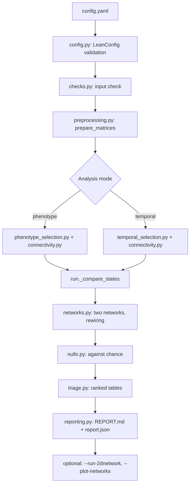

# PhenoRewire Architecture Reference

This document is the technical companion to `README.md`. The README is the user-facing source of truth; this file gives a code-aligned overview of how the repository is organized and how the main outputs are produced.

---

## 1. Purpose

PhenoRewire is a hypothesis-generating metabolomics workflow for detecting network rewiring between two comparable biological states.

Conceptually, the pipeline has four stages:

1. **Selection**: identify features associated with phenotype or time (abundance) or, with at least 14 samples per state, features whose co-variation partners change (connectivity)
2. **Network construction**: build one correlation network per state
3. **Rewiring analysis**: compare those networks and rank the features whose network context changed the most
4. **Null models**: test whether the networks, and the difference between them, exceed chance

The abundance route is a rank-based association test (with a binary label, equivalent to a permutation Mann–Whitney test); the connectivity route adds features whose partners change without a change in abundance. It is not a causal inference framework or a machine-learning classifier.

---

## 2. Repository structure

| Path | Role |
|------|------|
| `phenorewire/` | Installable Python package and CLI |
| `phenorewire/twodn/` | Reusable 2D annotation and plotting helpers |
| `2d_network/` | Optional standalone two-layer figure workflow |
| `docs/` | User and technical documentation |
| `data/` | Bundled example inputs, including a small demo molecular network |
| `dev/tests/` | Unit and integration tests |

---

## 3. Main execution flow

The CLI entrypoint is `phenorewire/cli.py`. The top-level orchestration lives in `phenorewire/run.py`.



In code terms:

1. `config.py` validates the YAML config with `LeanConfig`
2. `checks.py` reads both tables the way the run will and stops with a readable message on data that cannot be analysed (no matching samples, negative intensities, a missing timepoint)
3. `preprocessing.py` filters and normalizes the feature matrix
4. `phenotype_selection.py` or `temporal_selection.py` selects features by abundance; `connectivity.py` adds features by change in co-variation partners when every state has at least 14 samples
5. `run._compare_states(...)`, shared by both modes, builds the two networks, compares them, runs the null models and writes the comparison folder
6. `triage.py` turns node and rewiring statistics into the ranked tables
7. `reporting.py` writes `REPORT.md` and `report.json`

Three small modules sit around the pipeline:

| Module | Role |
|---|---|
| `layout.py` | The only place that decides where an output file goes (`Comparison`, `RunInfo`) |
| `console.py` | What the terminal shows: numbered steps and warnings on screen, everything with timestamps in `run_info/run.log` |
| `checks.py` | The input check, also available alone as `phenorewire --config ... --check` |

---

## 4. Core modules

### `phenorewire/config.py`

Defines `LeanConfig`, the validated run configuration.

Important groups of parameters:

- input/output paths
- analysis mode
- feature-table and metadata column names
- selection thresholds
- network thresholds
- rewiring and triage settings
- optional 2D annotation settings:
  - `SPECREBOOT_NETWORK`
  - `PHENOREWIRE_NETWORK`
  - `MN_HOP_DEPTH`
  - `MN_MIN_COSINE`
  - `ANNOTATION_TOP_N`

### `phenorewire/checks.py`

`check_inputs(config)` returns a `DataCheck` with summary lines, warnings and errors, and the comparisons the run will make with their sample sizes. It never raises on bad data; `run()` raises `InputDataError` when `DataCheck.ok` is false. The operating range (`operating_range(...)`) is defined here.

### `phenorewire/preprocessing.py`

`prepare_matrices(...)`:

- detects intensity columns using `INTENSITY_REGEX`
- aligns matrix sample names to metadata sample IDs (`matrix_sample_ids(...)`, shared with the input check)
- applies presence filtering
- applies median normalization
- applies optional `log2(x + 1)`
- removes zero-variance features

### `phenorewire/phenotype_selection.py`

Performs phenotype-associated feature selection using correlation to the binary phenotype label plus multiple-testing correction.

### `phenorewire/temporal_selection.py`

Performs temporal feature selection using correlation to the time variable within the chosen phenotype subset.

### `phenorewire/connectivity.py`

Connectivity-based selection: each feature's mean of its `top_k` largest changes in Spearman rho, against permuted state labels.

### `phenorewire/networks.py`

Contains the main network logic:

- `correlation_network(...)`
- `compute_network_metrics(...)`
- `compute_rewiring(...)`
- `summarize_rewiring(...)`
- `export_network(...)`
- `export_rewiring_network(...)`

Correlation networks are undirected `networkx.Graph` objects derived from thresholded Spearman correlations.

### `phenorewire/nulls.py`

Null models, reported next to every network and comparison when `NULL_MODEL.enabled` (the default):

- `network_edge_null(...)`: edges of one state network against features permuted independently within the state
- `modularity_null(...)`: unweighted Louvain modularity against degree-preserving (configuration-model) rewirings
- `rewiring_label_null(...)`: state-specific edges of a comparison against permuted state labels, with each feature centred within its state; also a per-feature test

Every null replicate is filtered by `networks.pairwise_spearman()` and `networks.edge_mask()`, the same functions that build the observed networks, with the thresholds the observed network applied. `run.py` checks that the null module rebuilds the observed counts exactly and stops if it does not.

### `phenorewire/triage.py`

Two pure functions; `run.py` writes their output:

- `rank_network_nodes(...)` adds `topology_priority_score`, `selection_support_score` and `triage_score` to the nodes of one network and sorts them (written as `details/network_<state>/nodes.csv`)
- `rewired_metabolites(...)` joins, for every selected metabolite, its name, selection route, direction, rewiring counts and per-metabolite null test, sorted by `q_rewiring` then `rewiring_score` (written as `rewired_metabolites.csv`)

### `phenorewire/stats.py`

The statistics shared by both selection routes, so a p-value means the same thing wherever it is produced:

- `spearman_permutation_test(...)` Spearman rho of each feature against a label or a time vector, with its permutation p-value. Permutations are drawn from one generator consumed feature by feature, the scheme every published analysis was run with
- `adaptive_fdr_selection(...)` Benjamini-Hochberg at the configured alpha, relaxed towards the configured ceiling only when fewer than the required number of features pass, and reported as the alpha actually applied

### `phenorewire/utils.py`

Small shared helpers with no dependency on the rest of the package: the normalisers behind `NORM_METHOD` (`median_normalize`, `pqn_normalize`, `tic_normalize`, and the `NORMALIZERS` map that `preprocessing.py` looks them up in), `safe_log2p1`, `assign_groups` (which labels an unmatched sample `"Unknown"`), and the timepoint helpers `parse_time_numeric` and `timepoint_label` that both `run.py` and `checks.py` use.

### `phenorewire/twodn/chemical_integration.py`

Implements the package-integrated 2D annotation workflow used by:

```bash
phenorewire --config config_phenotype.yaml --run-2dnetwork
```

This module:

- loads the rewiring GraphML and an external molecular network GraphML
- takes the top PhenoRewire-prioritized features
- searches `k`-hop neighbours in the molecular network
- filters traversed edges by a cosine/similarity threshold
- writes CSV tables summarizing suggested annotations from local neighbourhoods

It is a neighbourhood-based annotation expansion workflow, not a PageRank, diffusion, or random-walk implementation.

---

## 5. Output semantics

### `rewiring_score`

```text
rewiring_score =
    state_A_only_edges
  + state_B_only_edges
  + sign_switch_edges
```

Higher values mean more rewired local context.

### `rewiring_fraction`

```text
rewiring_fraction =
    (state_A_only_edges + state_B_only_edges) / total_union_degree
```

This normalizes state-specific rewiring by total connectivity.

### `q_rewiring`

Benjamini–Hochberg q of the per-metabolite label-permutation test in `nulls.rewiring_label_null(...)`: is this metabolite's count of state-specific edges larger than over permuted state labels? `rewired_metabolites.csv` is sorted by it.

### `triage_score`

```text
triage_score =
    TRIAGE_TOPOLOGY_WEIGHT * topology_priority_score
  + TRIAGE_SELECTION_WEIGHT * selection_support_score
```

A per-network ranking (topology plus selection strength), used to order `details/network_<state>/nodes.csv`. It does not order `rewired_metabolites.csv`.

---

## 6. Output files

`layout.py` defines every path; [`reading_the_results.md`](reading_the_results.md) explains every column.

```text
OUTDIR/
├── REPORT.md, report.json
├── <comparison>/
│   ├── rewiring_vs_chance.csv       nulls.rewiring_label_null, comparison level
│   ├── rewired_metabolites.csv      triage.rewired_metabolites
│   ├── selected_metabolites.csv     selection + direction columns
│   ├── rewiring_network.graphml     networks.export_rewiring_network
│   └── details/
│       ├── selection/               all_features_tested.csv, all_features_connectivity.csv, selection_summary.json
│       ├── network_<state>/         nodes.csv, edges.csv, communities.csv, network_summary.csv, null_model.csv, network.graphml
│       ├── rewiring/                edges.csv, rewiring_summary.csv
│       └── samples_used.csv
└── run_info/                        run.log, data_check.txt, config_used.yaml, samples.csv, feature_annotation.csv, preprocessed_matrix.csv
```

The comparison folder is `<ref>_vs_<case>` (phenotype) or `<group>_<T1>_vs_<T2>` (temporal). Optional extras write inside it: `molecular_network/` (`--run-2dnetwork`) and `plots/` (`--plot-networks`).

---

## 7. 2D molecular network annotation

PhenoRewire has two related 2D workflows.

### A. Package-integrated annotation workflow

Run:

```bash
phenorewire --config config_phenotype.yaml --run-2dnetwork
```

Purpose:

- start from PhenoRewire-prioritized rewired features
- search annotated neighbours in an external molecular/chemical similarity network
- suggest annotations from local `k`-hop neighbourhoods
- write CSV outputs for downstream review

Required inputs:

1. a rewiring GraphML from the PhenoRewire run (each comparison's `rewiring_network.graphml`, found automatically, or `PHENOREWIRE_NETWORK`)
2. an external molecular network GraphML
3. matching node IDs between the rewiring network and molecular network
4. a usable edge similarity attribute such as `cosine`
5. node annotation attributes such as `consensus_annotation`

Key config fields:

- `SPECREBOOT_NETWORK`
- `PHENOREWIRE_NETWORK`
- `MN_HOP_DEPTH`
- `MN_MIN_COSINE`
- `ANNOTATION_TOP_N`

Main outputs, in `<comparison>/molecular_network/`:

- `annotation_summary.csv`
- `annotation_expansion.csv`
- `annotation_first_neighbours.csv`
- `subnetworks/*.graphml`

The current implementation uses breadth-first neighbourhood traversal over an undirected graph and computes:

```text
annotation_confidence = annotated_neighbours / total_reachable_neighbours
```

### B. Standalone figure workflow

Run:

```bash
python 2d_network/multilayer_2d_notebook.py --config 2d_network/2d_figure_phenotype.yaml
```

This workflow is optional and is mainly for generating the two-layer figure. It is separate from the package-integrated CSV annotation workflow.

Plotting extras:

```bash
pip install "phenorewire[viz]"
```

---

## 8. Notes for reviewers

- The README is intentionally the primary public install and usage document.
- `rewired_metabolites.csv` is ranked by the per-metabolite rewiring test (`q_rewiring`, then `rewiring_score`), not by `triage_score`.
- The package-integrated 2D workflow is table-oriented first; the standalone `2d_network/` script is figure-oriented.
